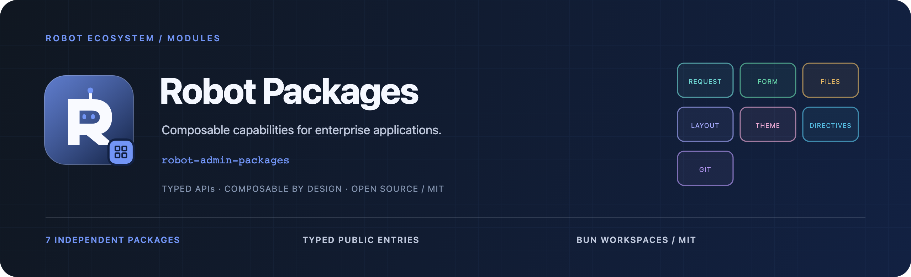

<!-- 品牌源文件与导出方式：docs/assets/README.md -->



<div align="center">
  <p><strong>把可复用能力做成独立包，让应用专注业务。</strong></p>
  <p>6 个运行时能力包 · 1 个工程工具 · 独立版本 · Bun Workspaces</p>
  <p>
    <a href="./package.json"></a>
    <a href="https://github.com/ChenyCHENYU/robot-admin-packages/actions/workflows/ci.yml"></a>
    <a href="./LICENSE"></a>
  </p>
  <p>
    <a href="#快速开始">快速开始</a> ·
    <a href="#包与能力地图">能力地图</a> ·
    <a href="./docs/maintenance.md">维护指南</a> ·
    <a href="https://github.com/ChenyCHENYU/Robot_Admin">Robot Admin</a>
  </p>
</div>

## 项目定位

**Robot Packages** 是 Robot Admin 公共能力的 Monorepo，包含请求、验证、文件、指令、布局、主题与 Git 工程工具。各包独立安装、独立版本、独立发布；应用按职责组合，无需接入整个 Robot Admin。

根项目是私有工作区容器，固定为 `private: true`、`version: 0.0.0`。使用方安装下表中的具体包；各包源码版本与 npm 线上状态分别以仓库清单和对应 npm 页面为准。

## 包与能力地图

| 包                                                     | 当前版本 | 核心职责与推荐入口                                                        |
| ------------------------------------------------------ | -------- | ------------------------------------------------------------------------- |
| [@robot-admin/request-core](./packages/request-core)   | `0.6.1`  | 请求编排与 Headless CRUD；按 `/axios`、`/vue`、`/naive` 选择依赖层级      |
| [@robot-admin/form-validate](./packages/form-validate) | `3.4.2`  | 框架无关 `RuleSpec`，统一 Naive UI、Element Plus 与批量校验               |
| [@robot-admin/file-utils](./packages/file-utils)       | `3.0.1`  | Excel、CSV、ZIP、图片、下载与可续传分片；按模块子路径消费                 |
| [@robot-admin/directives](./packages/directives)       | `2.0.1`  | 11 个 Vue 交互指令，应用级适配与生命周期清理                              |
| [@robot-admin/layout](./packages/layout)               | `3.2.1`  | 6 种布局、设置与宿主上下文；分为 `/core`、`/vue`、`/naive`                |
| [@robot-admin/theme](./packages/theme)                 | `0.6.1`  | 设计 Token、明暗状态和 UI 适配；分为 `/tokens`、`/core`、`/vue`、`/naive` |
| [@robot-admin/git-standards](./packages/git-standards) | `1.0.5`  | `init` / `doctor` CLI，生成团队 Git、Lint 与格式化配置                    |

### 按业务需要组合

| 目标               | 组合方式                                                                      |
| ------------------ | ----------------------------------------------------------------------------- |
| 搭建请求与列表状态 | `request-core/axios` 管理 Client，`request-core/vue` 管理查询、编辑与生命周期 |
| 复用校验与文件能力 | `form-validate` 定义规则，`file-utils` 处理导入导出、图片与分片               |
| 搭建 Vue 工作空间  | `layout/vue` 提供逻辑，`layout/naive` 提供视图，`theme` 管理主题语义          |
| 补齐细节交互       | 按需注册 `directives` 的复制、防抖、权限、拖拽等能力                          |
| 统一团队提交约定   | 在 Git 仓库根目录运行 `git-standards` 的初始化和诊断                          |

框架无关入口、Vue 层和具体 UI 适配各有边界。布局尚无 Element Plus 呈现层；主题的现有设计风格 CSS 面向 Naive UI / Robot 组件体系，不能据此推断已经提供其他 UI 适配。

## 快速开始

### 在应用中消费

例如只需要请求编排与校验：

```bash
bun add @robot-admin/request-core axios @robot-admin/form-validate
```

```ts
import { createRequestClient } from "@robot-admin/request-core/axios";
import { SPEC_RULES, validateValue } from "@robot-admin/form-validate";

const request = createRequestClient({ request: { baseURL: "/api" } });
const error = await validateValue("robot@example.com", [
  SPEC_RULES.email("邮箱"),
]);
```

后续按各包首页配置响应协议、peer 依赖与应用适配。这里的 `request` 只完成 Client 创建，网络调用由业务触发。

### 维护本仓库

仓库固定使用 **Bun 1.4.2**：

```bash
git clone https://github.com/ChenyCHENYU/robot-admin-packages.git
cd robot-admin-packages
bun install --frozen-lockfile
bun run verify
```

| 命令                      | 作用                                           |
| ------------------------- | ---------------------------------------------- |
| `bun run check:workspace` | 检查包清单、版本、锁文件、发布元数据与凭证边界 |
| `bun run type-check`      | 执行各包已声明的类型检查                       |
| `bun run test`            | 运行 Monorepo 测试                             |
| `bun run build`           | 顺序构建各包                                   |
| `bun run check:packages`  | 执行已声明的发布产物检查                       |
| `bun run verify`          | 按顺序运行以上完整门禁                         |

## 工程与联调

```text
robot-admin-packages/
├── packages/          # 七个独立发布包，各自维护 README / docs / CHANGELOG
├── docs/              # 维护、联调与品牌资源
├── scripts/           # 工作区任务执行与契约检查
├── .changeset/        # 包版本与用户可见变更
├── .github/workflows/ # 与本地 verify 共用门禁
└── bun.lock           # 唯一工作区锁文件
```

与 `Robot_Admin` 保持同级目录时，在应用仓库执行 `bun run dev:local` 可映射包源码进行 HMR 联调。发布消费验证使用应用的普通模式和精确 npm 版本，随后执行 `bun run type-build:installed`、测试与生产构建。具体步骤见[工作区开发与联调](./docs/workspace-guide.md)。

## 文档与协作

| 文档                                          | 内容                                           |
| --------------------------------------------- | ---------------------------------------------- |
| 各包首页                                      | 该包的定位、入口、快速开始、边界与完整指南     |
| [维护指南](./docs/maintenance.md)             | 新增包、质量门禁、版本发布、消费验证与失败恢复 |
| [工作区开发与联调](./docs/workspace-guide.md) | 工作区命令、相邻仓库联调和版本流程             |
| [品牌资源](./docs/assets/README.md)           | 整套 Robot 包 Logo、封面、配色及导出方式       |

子包用户可见能力变化通过 Changesets 独立发版。纯文档调整不修改包版本、不创建 Changeset；GitHub 文档随提交更新，已发布 npm 包内的 README 在后续发版时同步。

## Robot 生态

[Robot Admin](https://github.com/ChenyCHENYU/Robot_Admin) 提供应用与场景演示，[Naive UI Components](https://github.com/ChenyCHENYU/naive-ui-components) 提供业务组件，[Robot Cloud](https://github.com/ChenyCHENYU/Robot_Cloud) 提供认证和系统管理后端。本仓库负责按职责复用的公共能力。

## 许可证

[MIT License](./LICENSE) · Made by [CHENY](https://github.com/ChenyCHENYU)
