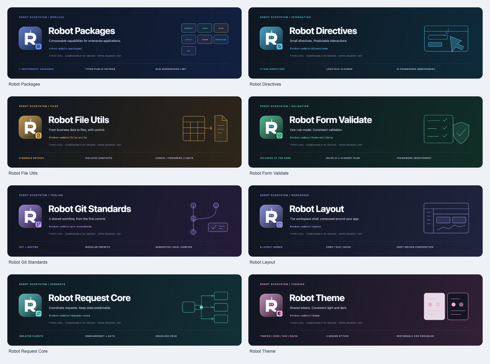

[← 仓库首页](../../README.md)

# Robot Packages 品牌资源

本套资源沿用 Robot 系列的几何 R、机器人双眼与天线。每个包用独立配色、角标和领域插画表达职责，封面结构保持一致。



## 资源索引

| 项目           | 识别色         | Logo                                                                                                                | 封面                                                                                                                    |
| -------------- | -------------- | ------------------------------------------------------------------------------------------------------------------- | ----------------------------------------------------------------------------------------------------------------------- |
| Robot Packages | 蓝 `#7295F6`   | [SVG](./logo.svg) · [PNG](./logo.png)                                                                               | [SVG](./banner.svg) · [PNG](./banner.png)                                                                               |
| Directives     | 天蓝 `#58C3E8` | [SVG](../../packages/directives/docs/assets/logo.svg) · [PNG](../../packages/directives/docs/assets/logo.png)       | [SVG](../../packages/directives/docs/assets/banner.svg) · [PNG](../../packages/directives/docs/assets/banner.png)       |
| File Utils     | 琥珀 `#EABB65` | [SVG](../../packages/file-utils/docs/assets/logo.svg) · [PNG](../../packages/file-utils/docs/assets/logo.png)       | [SVG](../../packages/file-utils/docs/assets/banner.svg) · [PNG](../../packages/file-utils/docs/assets/banner.png)       |
| Form Validate  | 绿 `#67D7AB`   | [SVG](../../packages/form-validate/docs/assets/logo.svg) · [PNG](../../packages/form-validate/docs/assets/logo.png) | [SVG](../../packages/form-validate/docs/assets/banner.svg) · [PNG](../../packages/form-validate/docs/assets/banner.png) |
| Git Standards  | 紫 `#B79AF7`   | [SVG](../../packages/git-standards/docs/assets/logo.svg) · [PNG](../../packages/git-standards/docs/assets/logo.png) | [SVG](../../packages/git-standards/docs/assets/banner.svg) · [PNG](../../packages/git-standards/docs/assets/banner.png) |
| Layout         | 靛蓝 `#A7ABFF` | [SVG](../../packages/layout/docs/assets/logo.svg) · [PNG](../../packages/layout/docs/assets/logo.png)               | [SVG](../../packages/layout/docs/assets/banner.svg) · [PNG](../../packages/layout/docs/assets/banner.png)               |
| Request Core   | 青 `#70DAD6`   | [SVG](../../packages/request-core/docs/assets/logo.svg) · [PNG](../../packages/request-core/docs/assets/logo.png)   | [SVG](../../packages/request-core/docs/assets/banner.svg) · [PNG](../../packages/request-core/docs/assets/banner.png)   |
| Theme          | 粉紫 `#EDABD6` | [SVG](../../packages/theme/docs/assets/logo.svg) · [PNG](../../packages/theme/docs/assets/logo.png)                 | [SVG](../../packages/theme/docs/assets/banner.svg) · [PNG](../../packages/theme/docs/assets/banner.png)                 |

各包资源目录：

- [Directives](../../packages/directives/docs/assets/)
- [File Utils](../../packages/file-utils/docs/assets/)
- [Form Validate](../../packages/form-validate/docs/assets/)
- [Git Standards](../../packages/git-standards/docs/assets/)
- [Layout](../../packages/layout/docs/assets/)
- [Request Core](../../packages/request-core/docs/assets/)
- [Theme](../../packages/theme/docs/assets/)

## 源文件与导出

每个资源目录包含 `logo.svg` / `logo.png` 和 `banner.svg` / `banner.png`：

- Logo：128 × 128 SVG，512 × 512 透明背景 PNG。
- 封面：1280 × 390 SVG，2560 × 780 PNG。
- SVG 自包含，不请求字体、图片或脚本；封面右侧为领域示意图。
- 各包的 `docs` 列入发布文件清单，以保留包内指南与本地图片。

修改 SVG 后，可在具备 Playwright 与 Chromium 的环境中使用以下代码导出。该工具仅用于文档维护，不属于包运行时依赖：

```js
import { chromium } from "playwright";
import { resolve } from "node:path";
import { pathToFileURL } from "node:url";

const assetDirectory = resolve("packages/theme/docs/assets");
const browser = await chromium.launch();
try {
  for (const [name, width, height, scale] of [
    ["banner", 1280, 390, 2],
    ["logo", 128, 128, 4],
  ]) {
    const page = await browser.newPage({
      viewport: { width, height },
      deviceScaleFactor: scale,
    });
    await page.goto(pathToFileURL(resolve(assetDirectory, `${name}.svg`)).href);
    await page
      .locator("svg")
      .first()
      .screenshot({
        path: resolve(assetDirectory, `${name}.png`),
        omitBackground: true,
      });
    await page.close();
  }
} finally {
  await browser.close();
}
```
