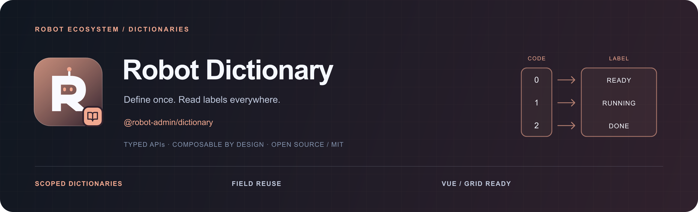

<!-- 品牌源文件与导出方式：../../docs/assets/README.md -->



<div align="center">
  <p><strong>接口接入一次，字段直接声明字典码。</strong></p>
  <p>静态枚举 · 远程字典 · 字段配置复用 · 按需加载 · 作用域隔离</p>
  <p>
    <a href="https://www.npmjs.com/package/@robot-admin/dictionary"></a>
    <a href="https://github.com/ChenyCHENYU/robot-admin-packages/actions/workflows/ci.yml"></a>
    <a href="./LICENSE"></a>
  </p>
  <p>
    <a href="#插件化接入">插件接入</a> ·
    <a href="#按场景使用">场景索引</a> ·
    <a href="./docs/guide.md">完整指南</a> ·
    <a href="https://github.com/ChenyCHENYU/robot-admin-packages">包总览</a>
  </p>
</div>

## 项目定位

**Robot Dictionary** 统一字典选项、加载状态和字段翻译。业务模型保存原始编码，表单、搜索、详情和表格共用同一份来源。

当前仓库版本 **0.5.0**。根入口无框架、UI 或请求库依赖；Vue 能力通过 `/vue` 按需使用。

## 插件化接入

Vue 项目只使用本包的 `/vue` 入口。接口、枚举与默认策略集中在一个可选配置文件；字典插件不依赖任何 UI 组件库。

```bash
bun add @robot-admin/dictionary
# Vue 适配需要项目已有 vue >= 3.4
```

**1. 配置一次**，放在项目已有的配置目录：

```ts
// src/config/dictionary.ts
import { getDictionaryOptionsApi } from "../api/dictionary";

export default {
  load: getDictionaryOptionsApi,
};
```

`getDictionaryOptionsApi(code, { signal, scope })` 返回 `{ value, label, disabled? }[]`。接口响应解包只适配一次，见[接口接入](./docs/guide.md#一插件与配置接入一次)。默认缓存 5 分钟、失败冷却 5 秒、超时 15 秒，配置文件只写需要覆盖的项。

**2. 安装插件**，`app` 是项目已创建的 Vue 应用：

```ts
import { createDictionaryPlugin } from "@robot-admin/dictionary/vue";
import dictionaryConfig from "./config/dictionary";

app.use(createDictionaryPlugin(dictionaryConfig));
```

插件按应用创建实例，负责配置、注入、响应式作用域与卸载。创建插件和声明字段都不请求接口，消费时才加载。仅使用静态枚举时可不配置 `load`；新项目不需要引入 NUI、MachTable 或它们的注入 key。

## 独立 Vue 页面

原生控件或任意 UI 框架都能直接取字典：

```ts
import { useDictionary } from "@robot-admin/dictionary/vue";

const { options, loading, error, reload, label } = useDictionary("user_status");
```

详情复用已有记录 `user` 和字段 `fields`，`fields` 中已有 `dictionary` 声明：

```ts
import { useDictLabels } from "@robot-admin/dictionary/vue";

const { labels } = useDictLabels(user, fields);
```

```vue
<span>{{ labels.account }}</span>
```

RobotAdmin 已安装插件，并自动导入 `useDictLabels`；页面无需再写这个 import。以上 hooks 均由字典包提供，完整变量与模板见[场景指南](./docs/guide.md#二接入后按场景使用)。

## 按场景使用

| 场景                         | 使用方式                                               | 完整示例                                                       |
| ---------------------------- | ------------------------------------------------------ | -------------------------------------------------------------- |
| 独立 Vue                     | `useDictionary("user_status")`，直接绑定原生或任意下拉 | [通用读法](./docs/guide.md#独立-vue原生或其他组件库)           |
| 表单下拉                     | `prop/type/dictionary`，提交仍为原码                   | [表单](./docs/guide.md#场景一表单下拉)                         |
| 搜索条件                     | `prop/type/dictionary`，搜索传原码                     | [搜索](./docs/guide.md#场景二搜索条件)                         |
| C_Table                      | `key/title/dictionary`，异步自动更新标签               | [C_Table](./docs/guide.md#场景三c_table-列表)                  |
| 详情、弹窗                   | 复用字段，读取 `labels.field`；按可见状态启用          | [详情](./docs/guide.md#场景四详情和弹窗)                       |
| MachTable                    | 公共字典列策略，异步合并刷新                           | [MachTable](./docs/guide.md#场景五machtable)                   |
| 静态枚举、专属接口、页面覆盖 | 只声明确有差异的名称                                   | [覆盖与枚举](./docs/guide.md#场景六静态枚举专属接口和页面覆盖) |
| 提示、脚本、导出前准备       | 显式加载，再同步 `source.label(value)`                 | [脚本翻译](./docs/guide.md#场景七脚本提示和导出前准备)         |

Naive UI Components ≥0.26 的表单、搜索与 C_Table 自动消费插件公开协议；MachTable 复用同一个 Store。**枚举翻译与状态配色分别配置**，普通字典不会自动全部变成彩色状态标签。

## 默认行为与边界

- 成功空字典和加载失败分别处理；失败保留同作用域旧标签，并提供局部错误和重试。见[空与失败](./docs/guide.md#三空失败与重试)。
- 默认成功缓存 5 分钟、失败冷却 5 秒、超时 15 秒；同码请求合并，不在单元格内请求或订阅。
- `0`、`false`、`"0"` 和 `"001"` 严格区分；未知值保留原码，翻译不回写模型。
- 多选数组逐项翻译；停用项保留历史标签。身份切换、失效和销毁见[生命周期](./docs/guide.md#四身份切换维护与性能边界)。
- 适合可整份读取的小字典；大型客户、物料、组织树使用分页检索或按码批量查询。

## 文档与维护

| 文档                                                                                             | 内容                                     |
| ------------------------------------------------------------------------------------------------ | ---------------------------------------- |
| [完整指南](./docs/guide.md)                                                                      | 接入步骤、七类使用场景、错误恢复与 API   |
| [RobotAdmin 项目用法](https://github.com/ChenyCHENYU/Robot_Admin/blob/main/docs/dictionaries.md) | 已接入项目直接怎么写、配置位置与体验入口 |
| [变更记录](./CHANGELOG.md)                                                                       | 版本变化与兼容性                         |

在本包目录运行 `bun run verify`；工作区完整门禁使用根目录同名命令。`bun run check:vue-min` 单独冷安装声明的最低 Vue 版本验证兼容性，不改变工作区依赖。

## 许可证

[MIT License](./LICENSE) · Robot Packages
