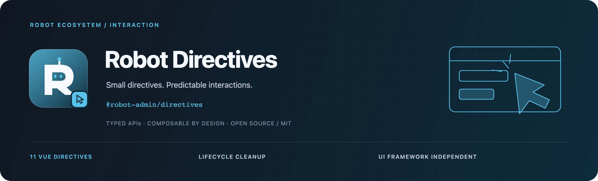

<!-- 品牌源文件与导出方式：../../docs/assets/README.md -->



<div align="center">
  <p><strong>把复制、防抖与权限等交互，收敛为可预测的指令。</strong></p>
  <p>Vue 3 · TypeScript · 11 个指令 · 按需子路径</p>
  <p>
    <a href="https://www.npmjs.com/package/@robot-admin/directives"></a>
    <a href="https://github.com/ChenyCHENYU/robot-admin-packages/actions/workflows/ci.yml"></a>
    <a href="./LICENSE"></a>
  </p>
  <p>
    <a href="#快速开始">快速开始</a> ·
    <a href="#能力地图">能力地图</a> ·
    <a href="./docs/guide.md">完整指南</a> ·
    <a href="https://github.com/ChenyCHENYU/robot-admin-packages">包总览</a>
  </p>
</div>

## 项目定位

**Robot Directives** 为 Vue 3 提供 11 个通用交互指令，以 `@robot-admin/directives` 发布。它关注 DOM 交互、应用级权限和反馈适配，以及挂载、更新、卸载时的资源清理，无运行时 UI 框架依赖。

当前仓库版本 **2.0.1**。支持 ESM、CommonJS、类型声明与逐指令子路径；适合现有 Vue 应用按需补齐交互能力。

## 能力地图

| 指令                        | 主要能力                                               |
| --------------------------- | ------------------------------------------------------ |
| `v-copy`                    | 动态文本、异步文本、Clipboard 降级、键盘支持与复制反馈 |
| `v-debounce` / `v-throttle` | handler 事件模式、leading / trailing 与动态事件        |
| `v-drag` / `v-longpress`    | 指针交互、边界／网格、长按容差与取消                   |
| `v-permission`              | 应用级权限 Provider、AND / OR、通配符与三种降级        |
| `v-watermark` / `v-lazy`    | 多行水印、图片／背景懒加载、更新竞态处理               |
| `v-loading` / `v-tooltip`   | 加载反馈、焦点提示、ARIA、CSP nonce                    |
| `v-click-outside`           | 外部点击、排除项、Shadow DOM 与共享监听                |

## 快速开始

需要 **Vue ≥3.3.0**：

```bash
bun add @robot-admin/directives vue@^3.3.0
```

### 局部使用

`<script setup>` 中的 `vDebounce` 可直接作为模板指令使用：

```vue
<script setup lang="ts">
import { ref } from "vue";
import vDebounce from "@robot-admin/directives/debounce";

const keyword = ref("");
const search = (event: Event) => {
  keyword.value = (event.target as HTMLInputElement).value;
};
</script>

<template>
  <input
    v-debounce:input="{ handler: search, delay: 300 }"
    placeholder="输入关键词"
  />
  <p>防抖后的关键词：{{ keyword }}</p>
</template>
```

新代码推荐由指令持有 `handler`。`v-debounce="300" @click="save"` 等旧事件模式仍兼容，迁移方式见[完整指南](./docs/guide.md#推荐事件模式)。

### 应用级注册

```ts
// main.ts
import { createApp } from "vue";
import { createDirectives } from "@robot-admin/directives";
import App from "./App.vue";

createApp(App)
  .use(createDirectives({ prefix: "ra-" }))
  .mount("#app");
```

此时模板使用 `v-ra-copy`、`v-ra-loading` 等名称。权限数据和消息回调通过 `createDirectives({ permission, notify })` 接入，详见[注册与适配](./docs/guide.md#注册)。

## 入口与应用边界

| 需求               | 选择                                               |
| ------------------ | -------------------------------------------------- |
| 全量注册与统一适配 | 根入口 `createDirectives(options)`                 |
| 单项交互           | `/copy`、`/debounce`、`/permission` 等 11 个子路径 |
| 兼容原项目         | 根入口 `setupDirectives(app, options)`             |
| Nuxt / SSR         | 客户端插件内注册；根模块导入不主动访问 DOM         |

状态按元素隔离；卸载清理计时器、Observer、全局监听和临时 DOM。权限指令控制界面呈现，接口授权由服务端执行。Loading / Tooltip 可传 `styleNonce`；复制需要浏览器能力支持，水印防删除也只是客户端交互措施。

## 文档与维护

| 文档                                        | 内容                                            |
| ------------------------------------------- | ----------------------------------------------- |
| [完整指南](./docs/guide.md)                 | 11 项指令用法、权限／消息适配、类型与浏览器边界 |
| [2.x 迁移](./docs/guide.md#从-1x-升级到-2x) | 事件模式、长按回调、权限和生命周期变化          |
| [安全策略](./SECURITY.md)                   | 权限、内容与运行环境说明                        |
| [变更记录](./CHANGELOG.md)                  | 版本变化                                        |

在本包目录运行 `bun run type-check`、`bun run test`、`bun run build`；整个工作区提交前运行根目录的 `bun run verify`。

## 许可证

[MIT License](./LICENSE) · Robot Packages
