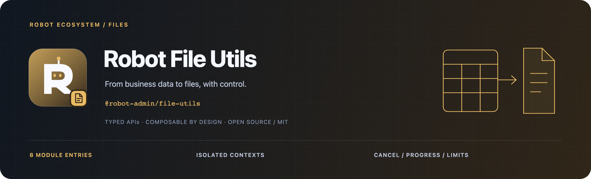

<!-- 品牌源文件与导出方式：../../docs/assets/README.md -->



<div align="center">
  <p><strong>让导入、导出和大文件传输，有统一的边界与反馈。</strong></p>
  <p>Excel · CSV · ZIP · Image · Download · Chunk Transfer</p>
  <p>
    <a href="https://www.npmjs.com/package/@robot-admin/file-utils"></a>
    <a href="https://github.com/ChenyCHENYU/robot-admin-packages/actions/workflows/ci.yml"></a>
    <a href="./LICENSE"></a>
  </p>
  <p>
    <a href="#快速开始">快速开始</a> ·
    <a href="#能力地图">能力地图</a> ·
    <a href="./docs/guide.md">完整指南</a> ·
    <a href="https://github.com/ChenyCHENYU/robot-admin-packages">包总览</a>
  </p>
</div>

## 项目定位

**Robot File Utils** 是面向浏览器与 Vue 3 应用的文件处理工具集，以 `@robot-admin/file-utils` 发布。除格式处理外，还统一提供隔离配置、资源限额、结构化错误、取消信号与进度模型。

当前仓库版本 **3.0.4**。推荐为每个应用或测试创建独立实例，按模块子路径选择能力。

## 能力地图

| 模块入口    | 提供能力                                                            |
| ----------- | ------------------------------------------------------------------- |
| `/excel`    | 工作簿读取、Excel 导出、模板与报表；采用 SheetJS 官方 `xlsx 0.20.3` |
| `/csv`      | RFC 4180 解析／生成、BOM、列结构约束与公式策略                      |
| `/file`     | 文本、JSON、XML、Base64 与文件读取                                  |
| `/image`    | 压缩、裁剪、格式转换、尺寸处理与可选签名校验                        |
| `/zip`      | 文件归档、模板与报表打包、路径和资源上限                            |
| `/download` | 下载响应归一化、文件名处理与浏览器保存                              |
| `/chunk`    | 分片上传、断点续传、重试、哈希与 sink 流式下载                      |
| `/config`   | 隔离上下文、默认限额与兼容全局配置                                  |

## 快速开始

需要 **Vue ≥3.3.0** peer：

```bash
bun add @robot-admin/file-utils vue@^3.3.0
```

### 创建实例并导出 Excel

```ts
import { createFileUtils } from "@robot-admin/file-utils";

const files = createFileUtils({
  limits: { maxRows: 50_000 },
});

export async function exportContacts() {
  const rows = files.csv.parse("姓名,部门\nRobot,Engineering");
  return files.excel.exportToExcel(rows, { fileName: "contacts.xlsx" });
}
```

在浏览器按钮事件中调用 `exportContacts()`。实例包含 `csv`、`file`、`image`、`excel`、`zip`、`download()`、`chunkUpload()` 和 `chunkDownload()`；消息和日志默认静默，按需注入应用适配器。

### 只使用 CSV

```ts
import { useCSV } from "@robot-admin/file-utils/csv";

const csv = useCSV();
const rows = csv.parse("name,enabled\nRobot,true");
```

ESM、CommonJS 与声明文件均提供显式入口。SheetJS 运行时与工作簿类型已随包提供，使用侧不需要安装 `xlsx` 或访问其 CDN；`jszip` 仍是独立运行依赖。CSV、下载、文件、图片、分片与配置子路径不会加载电子表格运行时。上游来源与许可见 [第三方声明](./THIRD_PARTY_NOTICES.md)。

## 可靠性与使用边界

| 关注点     | 当前行为                                                            |
| ---------- | ------------------------------------------------------------------- |
| 资源使用   | 文件大小、行列、图片像素、ZIP 与缓冲下载各有限额，按业务需要覆盖    |
| 数据与路径 | CSV / Excel 默认转义潜在公式；XML 转义；ZIP 路径清洗                |
| 取消与错误 | 主要操作接入 `AbortSignal`，通过 `FileUtilsError.code` 区分失败     |
| 传输进度   | 以字节为基础提供进度、速度和预计剩余时间                            |
| 大文件下载 | 传入 sink 时逐块写入；无 sink 时仍受内存缓冲上限约束                |
| 上传完整性 | 默认 sampled 哈希用于协商；全文件 SHA-256 需显式 `hashMode: 'full'` |

Canvas、FileReader、浏览器下载和 File System Access 等操作依赖相应环境。完整文件哈希需要读取整个 Blob；服务端仍负责最终内容、权限与合并完整性校验。SSR 能力与默认限额见[完整指南](./docs/guide.md)。

## 文档与维护

| 文档                                                   | 内容                                            |
| ------------------------------------------------------ | ----------------------------------------------- |
| [完整指南](./docs/guide.md)                            | 初始化、默认限额、错误模型、八类模块及 SSR 边界 |
| [分片上传](./docs/guide.md#可续传分片上传)             | 续传、取消、重试、sampled / full 哈希           |
| [流式下载](./docs/guide.md#真流式分片下载)             | sink 接入、预期大小与失败中止                   |
| [3.x 迁移](./docs/guide.md#从-2x-升级到-3x)            | 隔离实例、错误语义与资源策略变化                |
| [安全策略](./SECURITY.md) / [变更记录](./CHANGELOG.md) | 安全边界与版本变化                              |

在本包目录运行 `bun run type-check`、`bun run test`、`bun run build`；整个工作区提交前运行根目录的 `bun run verify`。

## 许可证

[MIT License](./LICENSE) · Robot Packages
