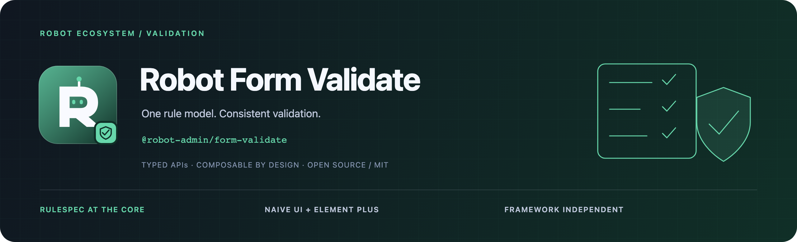
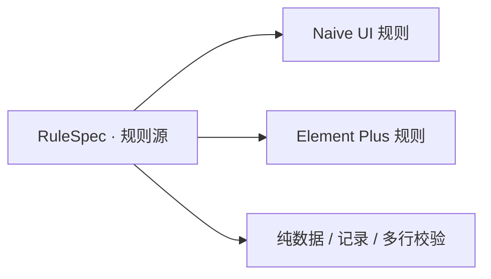

<!-- 品牌源文件与导出方式：../../docs/assets/README.md -->



<div align="center">
  <p><strong>一份规则定义，贯通界面校验与数据提交。</strong></p>
  <p>RuleSpec · Naive UI · Element Plus · 批量校验 · 零运行时依赖</p>
  <p>
    <a href="https://www.npmjs.com/package/@robot-admin/form-validate"></a>
    <a href="https://github.com/ChenyCHENYU/robot-admin-packages/actions/workflows/ci.yml"></a>
    <a href="./LICENSE"></a>
  </p>
  <p>
    <a href="#快速开始">快速开始</a> ·
    <a href="#能力地图">能力地图</a> ·
    <a href="./docs/guide.md">完整指南</a> ·
    <a href="https://github.com/ChenyCHENYU/robot-admin-packages">包总览</a>
  </p>
</div>

## 项目定位

**Robot Form Validate** 以框架无关的 `RuleSpec` 为规则源，通过适配器输出 Naive UI 与 Element Plus 规则，也支持对纯数据执行校验。包名为 `@robot-admin/form-validate`，无需安装 Vue 或 UI 框架即可使用规则核心。

当前仓库版本 **3.4.2**。适用于表单实时反馈、导入数据检查、表格多行提交，以及 SQL 数值契约等场景。

## 能力地图

| 领域       | 提供能力                                                       |
| ---------- | -------------------------------------------------------------- |
| 基础与格式 | 必填、长度、数值、日期、邮箱、URL 与正则                       |
| 业务规则   | 手机号、身份证、银行卡、车牌、统一社会信用代码                 |
| 数值契约   | `numeric` 对齐整数及 SQL `DECIMAL(p,s)` 的精度、范围与边界     |
| 规则组合   | 条件、跨字段比较、OR / AND、自定义与防抖异步校验               |
| 数据提交   | `validateValue`、`validateRecord`、`validateRows` 返回首条失败 |
| 框架适配   | 同一套 `RuleSpec` 输出 Naive UI、Element Plus 或自定义规则     |



## 快速开始

```bash
bun add @robot-admin/form-validate
```

### 先校验一条数据

```ts
import { SPEC_RULES, validateRecord } from "@robot-admin/form-validate";

const rules = {
  name: [SPEC_RULES.required("姓名")],
  email: [SPEC_RULES.email("邮箱")],
};

const error = await validateRecord(
  { name: "Robot", email: "robot@example.com" },
  rules,
);
// 全部通过为 null；失败时返回 { field, message }
```

### 在表单中使用

```ts
import {
  NAIVE_COMBOS,
  PRESET_RULES,
  ELEMENT_COMBOS,
  ELEMENT_RULES,
} from "@robot-admin/form-validate";

const naiveRules = {
  name: NAIVE_COMBOS.username("用户名"),
  email: [PRESET_RULES.email("邮箱")],
};

const elementRules = {
  name: ELEMENT_COMBOS.username("用户名"),
  email: [ELEMENT_RULES.email("邮箱")],
};
```

`naiveRules` 传给 Naive UI 的表单规则，`elementRules` 传给 Element Plus。业务规则只需维护一次；需要跨界面与批量提交复用时，直接维护 `RuleSpec` 并调用 `toNaiveRules` / `toElementRules`。

## 入口选择与规则语义

所有公开 API 都从包根入口导入：

| 使用环境     | 推荐 API                                                               |
| ------------ | ---------------------------------------------------------------------- |
| 框架无关规则 | `SPEC_RULES`、`numeric`、`whenSpec`、`someSpec` / `everySpec`          |
| Naive UI     | `PRESET_RULES`、`NAIVE_COMBOS`；`RULE_COMBOS` 为兼容名称               |
| Element Plus | `ELEMENT_RULES`、`ELEMENT_COMBOS`、`whenElement`                       |
| 提交前校验   | `validateValue`、`validateRecord`、`validateRows`                      |
| 自定义适配   | `toNaiveRule(s)`、`toElementRule(s)`、`createSpec` / `createAsyncSpec` |

纯数据校验顺序执行，遇到首条失败即返回。可选字段使用相应命名空间的 `optional` 或核心 `optional()` 包装；跨字段规则通过 getter 读取最新模型。UI 触发与展示仍由使用侧表单控制，服务端也应执行业务校验。

## 文档与维护

| 文档                                   | 内容                                     |
| -------------------------------------- | ---------------------------------------- |
| [完整指南](./docs/guide.md)            | 按场景查找规则、数值契约、组合与适配示例 |
| [批量校验](./docs/guide.md#批量校验)   | 单值、记录与多行校验                     |
| [迁移说明](./docs/guide.md#从旧版迁移) | 旧分包与规则 API 的迁移                  |
| [变更记录](./CHANGELOG.md)             | 版本变化与兼容性                         |

在本包目录运行 `bun run verify`，覆盖类型、测试与构建；工作区完整门禁使用根目录的 `bun run verify`。

## 许可证

[MIT License](./LICENSE) · Robot Packages
