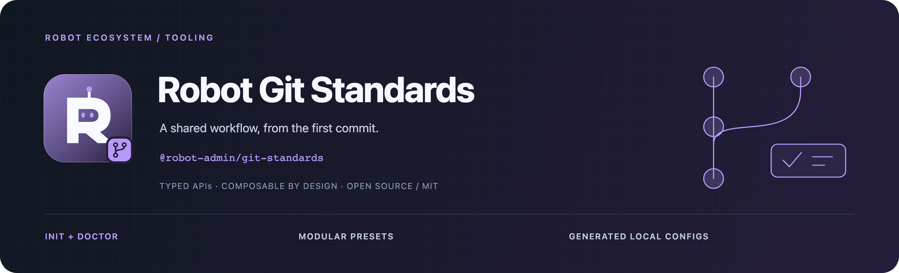

<!-- 品牌源文件与导出方式：../../docs/assets/README.md -->



<div align="center">
  <p><strong>从第一次提交开始，让团队使用同一套工程约定。</strong></p>
  <p>CLI · Init / Doctor · Vue / React / Vanilla · 本地配置生成</p>
  <p>
    <a href="https://www.npmjs.com/package/@robot-admin/git-standards"></a>
    <a href="https://github.com/ChenyCHENYU/robot-admin-packages/actions/workflows/ci.yml"></a>
    <a href="./LICENSE"></a>
  </p>
  <p>
    <a href="#快速开始">快速开始</a> ·
    <a href="#能力地图">能力地图</a> ·
    <a href="./docs/guide.md">完整指南</a> ·
    <a href="https://github.com/ChenyCHENYU/robot-admin-packages">包总览</a>
  </p>
</div>

## 项目定位

**Robot Git Standards** 是 Git 工程工具包，以 `@robot-admin/git-standards` 发布，CLI 名称为 `robot-standards`。它将 Commitizen、Commitlint、Husky 与可选的 Lint / 格式化工具组合为可重复执行的项目初始化流程。

当前仓库版本 **1.0.5**，运行需要 **Node.js ≥18.18.0**。生成的配置是项目自己的完整文件，可直接调整；应用运行时无需导入本包。

## 能力地图

| 能力       | 当前行为                                                    |
| ---------- | ----------------------------------------------------------- |
| `init`     | 检测 Git 根目录、识别包管理器、选择预设、安装依赖并生成配置 |
| `doctor`   | 检查配置、Hook 和本地依赖的真实可解析状态                   |
| 预设组合   | minimal、standard、full，以及交互式自定义                   |
| 框架选项   | Vue、React、Vanilla，TypeScript 与 JSDoc 可配置             |
| 重复初始化 | 覆盖生成文件前备份，保留已有 Hook，合并缺失脚本与工具配置   |
| 本地执行   | 生成 Hook 使用当前项目的工具，避免执行时隐式下载依赖        |

## 快速开始

在目标 **Git 仓库根目录** 安装并运行：

```bash
bun add -d @robot-admin/git-standards
bunx --no-install robot-standards init
bunx --no-install robot-standards doctor
```

`init` 会展示交互式配置与确认，并写入所选配置、补充开发依赖和 Hook。Monorepo 不应在子包中生成第二套 Git Hook；从其他目录发起时使用 `--cwd /path/to/repository` 指定根目录。

初始化后，使用项目生成的提交命令：

```bash
bun run cz
```

### CI 与非交互场景

```bash
bunx --no-install robot-standards init --ci --preset standard
```

`--ci` 按明确参数执行并写入文件，适合已确定配置的自动化环境。完整参数与生成内容见[使用指南](./docs/guide.md#ci--非交互模式)。

## 选择预设

| 预设         | 包含能力                                                | 适用场景                     |
| ------------ | ------------------------------------------------------- | ---------------------------- |
| `minimal`    | Commitizen、Commitlint、Husky commit-msg                | 只统一提交信息               |
| `standard`   | minimal + ESLint、lint-staged、EditorConfig、pre-commit | 常规团队工程                 |
| `full`       | standard + Prettier、Oxlint、JSDoc                      | 需要完整代码检查与格式化约定 |
| 交互式自定义 | 核心提交工具 + 自选附加项                               | 已有工程渐进接入             |

Commitizen、Commitlint 与 Husky 属于核心功能；其余按配置启用。安装发生在初始化阶段，提交阶段调用已安装的本地二进制。

## 配置所有权与诊断

| 关注点         | 约定                                               |
| -------------- | -------------------------------------------------- |
| 现有文件       | 生成文件覆盖前创建 `.bak`；已有 Hook 保留          |
| `package.json` | 补充缺失脚本、合并工具配置与 `lint-staged`         |
| 仓库位置       | Hook 属于整个 Git 仓库，`--cwd` 必须定位仓库根目录 |
| 问题定位       | 先运行 `doctor`，再检查实际 Hook 路径和本地依赖    |

本包生成团队工具配置，不提供业务权限、后端服务或运行时页面能力。初始化后的规则由目标项目维护。

## 文档与维护

| 文档                                                 | 内容                                        |
| ---------------------------------------------------- | ------------------------------------------- |
| [完整指南](./docs/guide.md)                          | 交互流程、CLI 参数、配置文件与提交链路      |
| [配置自定义](./docs/guide.md#配置自定义)             | ESLint、Commitizen、Prettier 和 Commitlint  |
| [Doctor 诊断](./docs/guide.md#doctor-诊断)           | 按已启用能力检查环境                        |
| [故障排除](./docs/guide.md#故障排除-troubleshooting) | Hook、依赖、Flat Config 与 Windows 常见问题 |
| [变更记录](./CHANGELOG.md)                           | 版本变化                                    |

本包的 `bun run verify` 覆盖 Lint、类型、测试、构建与发布产物；工作区提交前再执行根目录的完整门禁。

## 许可证

[MIT License](./LICENSE) · Robot Packages
