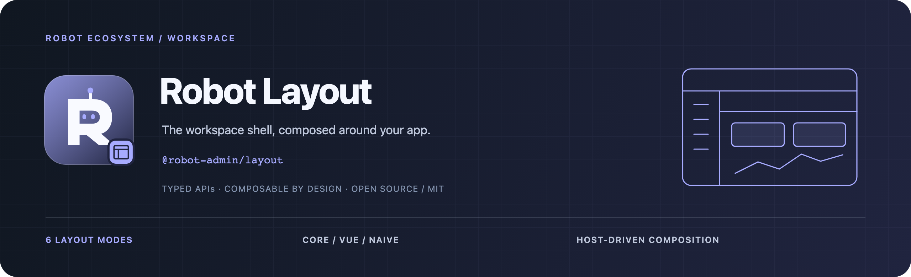

<!-- 品牌源文件与导出方式：../../docs/assets/README.md -->



<div align="center">
  <p><strong>把布局、设置与导航容器，组合成应用自己的工作空间。</strong></p>
  <p>6 种布局 · Core / Vue / Naive · 宿主上下文 · TypeScript</p>
  <p>
    <a href="https://www.npmjs.com/package/@robot-admin/layout"></a>
    <a href="https://github.com/ChenyCHENYU/robot-admin-packages/actions/workflows/ci.yml"></a>
    <a href="./LICENSE"></a>
  </p>
  <p>
    <a href="#快速开始">快速开始</a> ·
    <a href="#能力地图">能力地图</a> ·
    <a href="./docs/guide.md">完整指南</a> ·
    <a href="https://github.com/ChenyCHENYU/robot-admin-packages">包总览</a>
  </p>
</div>

## 项目定位

**Robot Layout** 提供布局设置协议、Vue 响应式上下文与 Naive UI 呈现，以 `@robot-admin/layout` 发布。`C_LayoutContainer` 根据模式选择骨架，应用提供菜单、品牌、头部、页签等业务内容。

当前仓库版本 **3.2.1**。已提供 6 种布局和设置抽屉；逻辑与视图分层，便于按宿主的 UI 技术选择入口。

## 能力地图

| 领域       | 提供能力                                                       |
| ---------- | -------------------------------------------------------------- |
| 布局骨架   | side、top、mix、mix-top、reverse-horizontal-mix、card-layout   |
| 设置管理   | 6 套颜色预设、尺寸、折叠、菜单展开、动画和显示开关             |
| 宿主组合   | `provideLayout()` 将最小设置、菜单、主题和品牌输入桥接为上下文 |
| 设置抽屉   | 外观、布局、功能配置及扩展插槽                                 |
| 响应式导航 | 菜单拆分、水平菜单测量、缓存判断与交互支持                     |
| 作用域     | 可指定 CSS 变量命名空间与挂载目标，并精确清理                  |

## 入口选择

| 场景                   | 推荐入口 | 依赖边界                                 |
| ---------------------- | -------- | ---------------------------------------- |
| 设置协议、校验与纯函数 | `/core`  | 无 Vue / Pinia / Router / UI 运行时      |
| 自有 UI 或复用布局逻辑 | `/vue`   | Vue、Pinia、Router，不导入 UI 库         |
| Naive UI 应用          | `/naive` | Vue 层 + 内置布局、菜单与 SettingsDrawer |
| 已有 3.x 应用          | 根入口   | 兼容聚合入口，包含 Naive UI 呈现         |

Element Plus 项目可以复用 `/core` 与 `/vue`，当前没有已发布的 Element Plus 布局呈现组件。

## 快速开始

以下用于已有 Vue Router 应用的 Naive UI 接入：

```bash
bun add @robot-admin/layout vue@^3.4.0 vue-router@^4.0.0 pinia@^3.0.0 naive-ui@^2.38.0
```

Pinia peer 支持 **2.x / 3.x**，已有 Pinia 2 项目可保留当前主版本。

### 初始化

```ts
// main.ts
import { createApp } from "vue";
import { createPinia } from "pinia";
import { setupLayout } from "@robot-admin/layout/naive";
import "@robot-admin/layout/naive/style";
import App from "./App.vue";
import router from "./router";

const app = createApp(App);
app.use(createPinia());
app.use(router);
setupLayout(app, { defaults: { layoutMode: "side" } });
app.mount("#app");
```

### 提供上下文与业务插槽

```vue
<script setup lang="ts">
import {
  C_LayoutContainer,
  provideLayout,
  useSettingsStore,
} from "@robot-admin/layout/naive";

provideLayout({
  settings: useSettingsStore(),
  menus: [],
  isDark: false,
  brand: { name: "My Admin", homePath: "/" },
});
</script>

<template>
  <C_LayoutContainer>
    <template #header>My Admin</template>
    <template #menu>在这里放置应用菜单</template>
  </C_LayoutContainer>
</template>
```

骨架内容区使用路由视图；应用保留自身路由配置。实际项目将 `menus`、`isDark` 替换为 Ref、ComputedRef 或 getter，使导航和主题随宿主更新。

## 设置与宿主职责

`SettingsDrawer` 需要位于 `NMessageProvider` 和 `NDialogProvider` 下。其清缓存动作通过宿主的 `actions.clearCache` 接入，布局包不会自行清空业务存储。主题切换可通过 `onThemeModeChange` 同步到应用主题系统。

外部设置导入会校验枚举、布尔值、数值范围和颜色；应用仍负责实际菜单数据、权限、路由、缓存策略和业务操作。

## 文档与维护

| 文档                                 | 内容                                            |
| ------------------------------------ | ----------------------------------------------- |
| [完整指南](./docs/guide.md)          | 接入、设置抽屉、布局模式、Store、CSS 变量与插槽 |
| [高级用法](./docs/guide.md#高级用法) | 自定义 Store、外部设置校验、迁移与单独骨架      |
| [变更记录](./CHANGELOG.md)           | 版本变化与 3.x 兼容信息                         |

本包的 `bun run verify` 覆盖类型、测试、构建与发布入口；整个工作区使用根目录的 `bun run verify`。

## 许可证

[MIT License](./LICENSE) · Robot Packages
