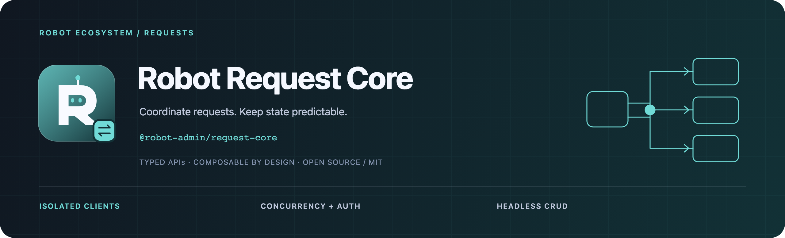

<!-- 品牌源文件与导出方式：../../docs/assets/README.md -->



<div align="center">
  <p><strong>让请求、认证恢复与列表状态，拥有一致的生命周期。</strong></p>
  <p>Axios · 隔离 Client · 并发策略 · Vue Headless CRUD</p>
  <p>
    <a href="https://www.npmjs.com/package/@robot-admin/request-core"></a>
    <a href="https://github.com/ChenyCHENYU/robot-admin-packages/actions/workflows/ci.yml"></a>
    <a href="./LICENSE"></a>
  </p>
  <p>
    <a href="#快速开始">快速开始</a> ·
    <a href="#能力地图">能力地图</a> ·
    <a href="./docs/guide.md">完整指南</a> ·
    <a href="https://github.com/ChenyCHENYU/robot-admin-packages">包总览</a>
  </p>
</div>

## 项目定位

**Robot Request Core** 是实例化请求编排与 Vue 3 Headless CRUD 工具，以 `@robot-admin/request-core` 发布。基于 Axios，统一处理并发、缓存、取消、重试、Token 恢复与数据列表生命周期。

当前仓库版本 **0.6.1**。每个 Client 隔离运行状态；Vue 层不绑定表格或 UI 组件，Naive UI 通过单独兼容适配层接入。

## 能力地图

| 领域          | 提供能力                                                |
| ------------- | ------------------------------------------------------- |
| 请求 Client   | 类型化方法、响应适配、拦截器与统一 `RequestError`       |
| 并发          | `join`、`takeLatest`、`takeFirst`、`allow`              |
| 缓存与重试    | LRU / TTL、标签失效、退避、抖动、Retry-After 与时间预算 |
| 认证恢复      | 主动刷新、并发 401 恢复与重新登录共用 single-flight     |
| Vue 请求      | `useRequest` 的数据、错误、loading、取消和过期结果隔离  |
| Headless CRUD | 数据源、分页查询、编辑器、详情、增删改与应用级预配置    |

## 入口选择

| 入口     | 依赖与用途                                                          |
| -------- | ------------------------------------------------------------------- |
| `/axios` | 仅 Axios；纯请求项目优先使用                                        |
| `/vue`   | Axios + Vue；注入、`useRequest`、`useTableCrud` / `createTableCrud` |
| `/naive` | Axios + Vue + Naive UI；`useNaiveTableCrud` 兼容适配                |
| 根入口   | 完整兼容聚合，当前仍引用 Naive UI                                   |
| `/crud`  | 已废弃的兼容入口，新代码选择 `/vue` 或 `/naive`                     |

## 快速开始

```bash
bun add @robot-admin/request-core axios@^1.7.0
```

Vue 能力另需 **Vue ^3.4**，Naive UI 适配另需 **Naive UI ^2.38**；两者均声明为可选 peer。

### 创建应用 Client

```ts
import { createRequestClient } from "@robot-admin/request-core/axios";

interface User {
  id: number;
  name: string;
}

const request = createRequestClient({
  request: { baseURL: "/api", timeout: 10_000 },
});

export function searchUsers(keyword: string) {
  return request.get<User[]>("/users", {
    params: { keyword },
    concurrency: "takeLatest",
    scope: "users-page",
  });
}
```

此例假设接口直接返回 `User[]`。若后端返回 `{ code, data, message }`，通过 `response` 适配器定义成功判定、数据解包与错误消息，见[完整接入](./docs/guide.md#推荐接入)。

### 给列表接入数据源

在 Vue 组件的 `setup` 中使用 `/vue`，HTTP 数据源复用同一个 Client：

```ts
import { useTableCrud } from "@robot-admin/request-core/vue";

const table = useTableCrud({
  client: request,
  source: { list: "/users" },
  autoLoad: "mounted",
  createNewRow: () => ({ id: 0, name: "" }),
});
```

此处 `request` 沿用上例创建的 Client。列表响应的字段映射按服务端协议配置；CRUD 不提供后端实现，也不要求使用特定表格。`createMemoryTableSource()` 可接入演示数据，`createTableCrud()` 可统一项目默认约定。

## 默认行为与边界

| 策略        | 默认与约定                                                       |
| ----------- | ---------------------------------------------------------------- |
| 缓存 / 重试 | 默认关闭，按 Client 或单次请求显式启用                           |
| 隐式去重    | 安全读取请求共享结果，副作用方法默认允许并发                     |
| 重试方法    | 默认允许 GET / HEAD / OPTIONS / PUT / DELETE；POST 不自动重试    |
| 认证恢复    | 提供真实 token、refresh 和重新登录回调后生效                     |
| 状态隔离    | Client 独立持有缓存、请求和认证状态；切换身份时建议清理业务缓存  |
| 卸载        | Vue 作用域结束取消请求，忽略晚到结果；观察回调不改写真实执行结果 |

`raw()` 返回完整 Axios 响应，其他方法返回适配后的数据。取消、HTTP、网络、超时、业务与配置错误可通过 `RequestError` 分类处理。

## 文档与维护

| 文档                                                   | 内容                                         |
| ------------------------------------------------------ | -------------------------------------------- |
| [完整指南](./docs/guide.md)                            | Client、响应适配、缓存、重试、认证与兼容迁移 |
| [Headless CRUD 专题](./docs/table-crud.md)             | source、函数式预配置、查询、编辑器与生命周期 |
| [安全策略](./SECURITY.md) / [变更记录](./CHANGELOG.md) | 认证边界与版本变化                           |

本包的 `bun run verify` 覆盖类型、测试、构建和发布产物；工作区完整门禁使用根目录的同名命令。

## 许可证

[MIT License](./LICENSE) · Robot Packages
