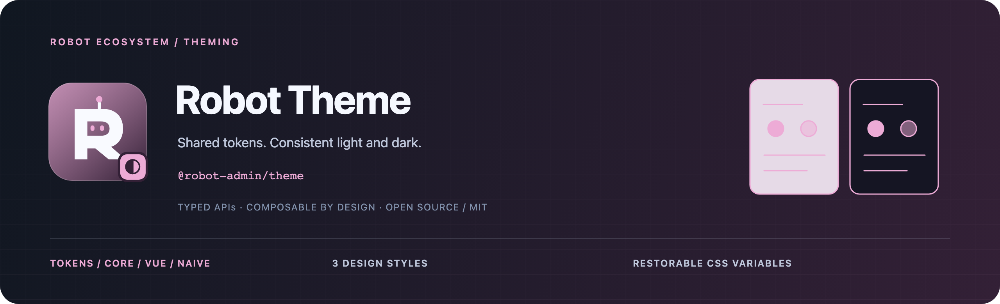

<!-- 品牌源文件与导出方式：../../docs/assets/README.md -->



<div align="center">
  <p><strong>用同一份设计语义，连接明暗主题、状态与界面。</strong></p>
  <p>Design Tokens · Light / Dark / System · Vue / Pinia · Naive UI</p>
  <p>
    <a href="https://www.npmjs.com/package/@robot-admin/theme"></a>
    <a href="https://github.com/ChenyCHENYU/robot-admin-packages/actions/workflows/ci.yml"></a>
    <a href="./LICENSE"></a>
  </p>
  <p>
    <a href="#快速开始">快速开始</a> ·
    <a href="#能力地图">能力地图</a> ·
    <a href="./docs/guide.md">完整指南</a> ·
    <a href="https://github.com/ChenyCHENYU/robot-admin-packages">包总览</a>
  </p>
</div>

## 项目定位

**Robot Theme** 是分层主题基础设施，以 `@robot-admin/theme` 发布。从框架无关的模式解析与设计 Token，到 Vue / Pinia 状态管理和 Naive UI 适配，按应用需要选择入口。

当前仓库版本 **0.6.1**。覆盖 light / dark / system 模式、3 套设计风格、同源标签页同步、可恢复 CSS Variables 与 View Transition 渐进增强。

## 能力地图

| 层级       | 提供能力                                                           |
| ---------- | ------------------------------------------------------------------ |
| 主题语义   | 模式校验、系统偏好解析与风格兼容归一化                             |
| 设计 Token | 基础色板、明暗语义、组件、间距、排版与动效，统一生成 CSS Variables |
| 状态管理   | Pinia Store、持久化、系统偏好与跨标签页同步                        |
| UI 适配    | Naive UI 的 `theme` / `themeOverrides` 响应式绑定                  |
| 风格样式   | Glass Morphism、Corporate Minimal、Dark Tech                       |
| 生命周期   | 幂等初始化、监听清理、Token 应用恢复与减少动态效果支持             |

## 入口选择

| 入口            | 依赖边界与用途                              |
| --------------- | ------------------------------------------- |
| `/core`         | 无框架依赖；模式解析、校验与元数据          |
| `/tokens`       | 无框架依赖；默认 Token、增量覆盖与 CSS 工具 |
| `/vue`          | Vue / Pinia；主题 Store 和 View Transition  |
| `/naive`        | Naive UI；响应式配置适配                    |
| `/tokens.css`   | 默认明暗语义变量                            |
| `/naive/styles` | 默认 Token CSS + 三套 Naive UI / Robot 风格 |
| 根入口          | 与 `/vue` 一致的兼容入口                    |

设计风格 CSS 当前面向 Naive UI / Robot `C_*` 体系。其他 UI 项目可以复用 `/core`、`/tokens`、`/vue`，再提供相应呈现适配。

## 快速开始

### 只使用 Token

```bash
bun add @robot-admin/theme
```

```ts
import {
  createThemeTokens,
  getThemeCssVariables,
} from "@robot-admin/theme/tokens";

const tokens = createThemeTokens({
  light: { color: { primary: "#5946e8" } },
  dark: { color: { primary: "#a89cff" } },
  radius: { md: "10px" },
});

const darkVariables = getThemeCssVariables(tokens, "dark");
```

`darkVariables` 是变量映射；写入与恢复可使用 `applyThemeTokens()`。项目仅提交需要变化的字段，未知字段和空值会被拒绝，完整语义见 [Token 设计](./docs/tokens.md)。

### Vue / Pinia 与 Naive UI

安装匹配的 peer，并先在 `main.ts` 中为应用注册 Pinia：

```bash
bun add vue@^3.4.0 pinia@^3.0.0 naive-ui@^2.38.0
```

Pinia 2.x 也受支持。以下放在根组件 `App.vue`，由根组件管理共享主题的初始化和销毁：

```vue
<script setup lang="ts">
import { onUnmounted } from "vue";
import { NConfigProvider } from "naive-ui";
import { useThemeStore } from "@robot-admin/theme/vue";
import { useNaiveTheme } from "@robot-admin/theme/naive";
import "@robot-admin/theme/naive/styles";

const theme = useThemeStore();
theme.init();
const { currentTheme, themeOverrides } = useNaiveTheme({
  isDark: () => theme.isDark,
  tokens: theme.tokens,
});
onUnmounted(() => theme.destroy());
</script>

<template>
  <NConfigProvider :theme="currentTheme" :theme-overrides="themeOverrides">
    <button @click="theme.toggleDark()">切换明暗</button>
  </NConfigProvider>
</template>
```

项目自定义 Token 用 `createThemeStore({ tokens })` 配置；不要维护第二份主题缓存。`overrides` 应是增量补丁，整套亮色配置会覆盖暗色基础值。

## 所有权与兼容边界

| 关注点       | 约定                                                                   |
| ------------ | ---------------------------------------------------------------------- |
| DOM 所有者   | 同一 document 默认保留一个主题所有者；Store id 不等于 DOM / 存储隔离   |
| 初始化与卸载 | `init()` 幂等，`destroy()` 移除监听并恢复由本实例应用的 Token          |
| 持久化       | 可注入 storage 或用 `null` 禁用；自定义 storage 不隐式启用 window 同步 |
| 菜单样式     | `data-menu-theme` 由 layout / 宿主管理，主题风格不接管菜单状态         |
| 动画         | 不支持 View Transition、reduced-motion 或动画中止时直接执行状态更新    |

## 文档与维护

| 文档                                                   | 内容                                            |
| ------------------------------------------------------ | ----------------------------------------------- |
| [完整指南](./docs/guide.md)                            | Store 配置、API、Naive UI、样式、迁移与生命周期 |
| [Token 设计](./docs/tokens.md)                         | 分层、变量清单、项目换肤与微应用清理            |
| [安全策略](./SECURITY.md) / [变更记录](./CHANGELOG.md) | 运行边界与版本变化                              |

本包的 `bun run verify` 覆盖类型、测试、构建与发布入口；工作区完整验证使用根目录的同名命令。

## 许可证

[MIT License](./LICENSE) · Robot Packages
